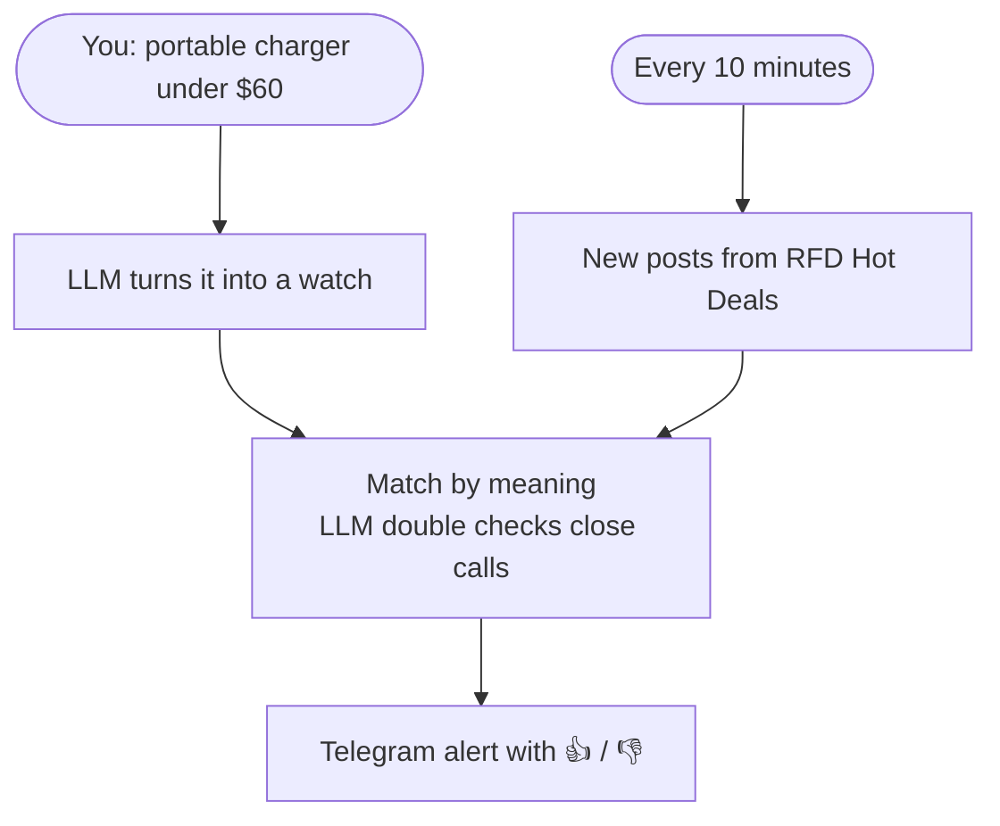
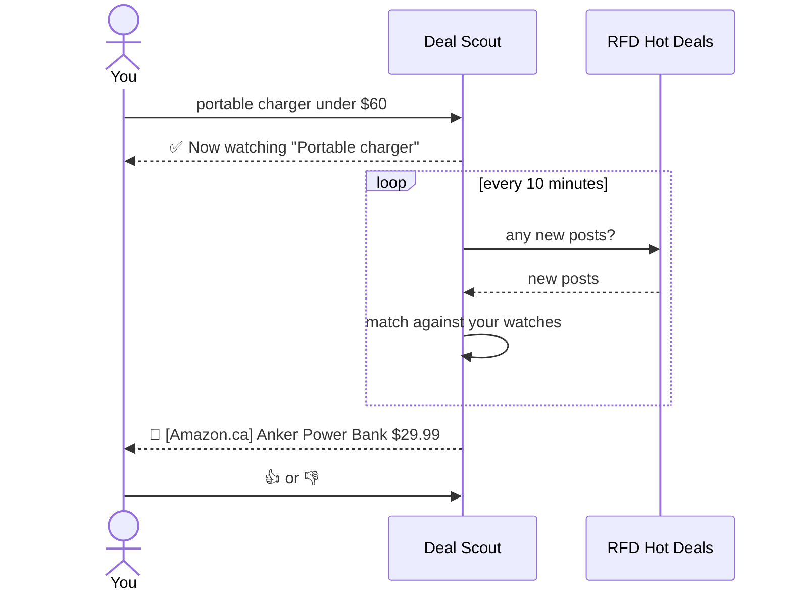

# Deal Scout

Deal Scout watches the RedFlagDeals Hot Deals forum and messages you on Telegram when a new post matches something you
asked for. Matching is by meaning, not keywords: "portable charger" matches "[Amazon] Anker 20000mAh Power Bank $29".

> Personal project for learning. It only reads the public Hot Deals Atom feed, every 10 minutes, and never scrapes
> forum pages.
>
> **In progress:** match thresholds are still being tuned, and Telegram hasn't been tested with a real bot yet, so it
> may not work as expected. Without Telegram, alerts show up in the Worker logs.

## How it works

- **Ask:** Send what you want in plain words. An LLM turns it into a watch with synonyms, brands, a price limit and
  excluded words.
- **Match:** Every 10 minutes new posts are embedded and scored against your watches, then filtered by price, store
  and excluded words.
- **Judge:** Borderline scores get a quick LLM yes/no check, capped per run and per day.
- **Alert:** Matches arrive in Telegram with 👍 / 👎. Enough 👎 makes that watch stricter.

Everything runs on the Cloudflare free plan (Workers, D1, Workers AI). No servers, no paid APIs. Claude Haiku is an
optional swap for the LLM parts.

## Architecture



## Setup

Requires Node 20+ and a free Cloudflare account.

```bash
npm install
npx wrangler login
cp wrangler.toml.example wrangler.toml
npx wrangler d1 create deal-scout        # paste the printed database_id into wrangler.toml
npm run db:migrate:remote
npx wrangler secret put ADMIN_TOKEN      # any long random string
npx wrangler secret put PAIRING_CODE     # you send /start <PAIRING_CODE> to your bot once
npm run deploy
```

Copy `.env.example` to `.env`, set `WORKER_URL` (printed by the deploy) and `ADMIN_TOKEN`, then run `npm run status`.

Telegram and Claude are optional. Without Telegram, alerts go to `npm run logs`. Settings live under `[vars]` in
`wrangler.toml`. The full walkthrough is in [docs/setup.md](docs/setup.md).

## Sequence Diagram



## Try it locally

```bash
npm install
npm run watch:add -- "ninja dual brew coffee maker"
npm run check -- --file test/fixtures/hot-deals-feed.xml --alert-existing --verbose
```

`--alert-existing` scores every post currently in the feed (roughly the last day), not just new ones, so you see
results right away. Matches show up in the logs, or in Telegram once it's set up. If it says "too soon", the cron just
ran: wait 2 minutes.

## Telegram

Create a bot with [@BotFather](https://t.me/BotFather), then:

```bash
npx wrangler secret put TELEGRAM_BOT_TOKEN
npx wrangler secret put TELEGRAM_WEBHOOK_SECRET   # letters, digits, _ and - only
npm run telegram:setup
```

Send your bot `/start <PAIRING_CODE>`, then message it what you're looking for. Still in progress, see
[docs/telegram.md](docs/telegram.md).

## Tune the thresholds

```bash
npm run labels:pull     # posts the deployed bot has seen
npm run labels:sync     # then label them in data/labeled-posts.json
npm run eval            # precision, recall and suggested thresholds
```

Thresholds are still being tuned. See [docs/tuning.md](docs/tuning.md).

## Tests

```bash
npm test             # 200+ tests, no network
npm run typecheck    # everything, plus Worker code without Node types
npm run bench        # CPU estimate against the free plan's 10 ms limit
```

## Docs

[Setup](docs/setup.md) · [Telegram](docs/telegram.md) · [Admin API and CLI](docs/admin-api.md) · [Tuning](docs/tuning.md) · [Architecture](docs/architecture.md)
